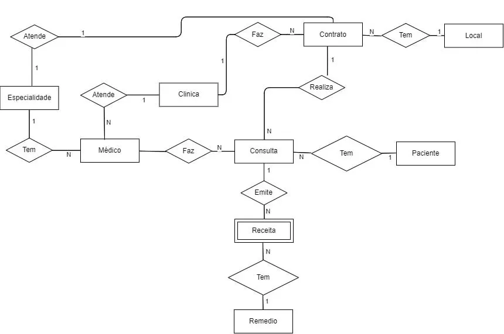
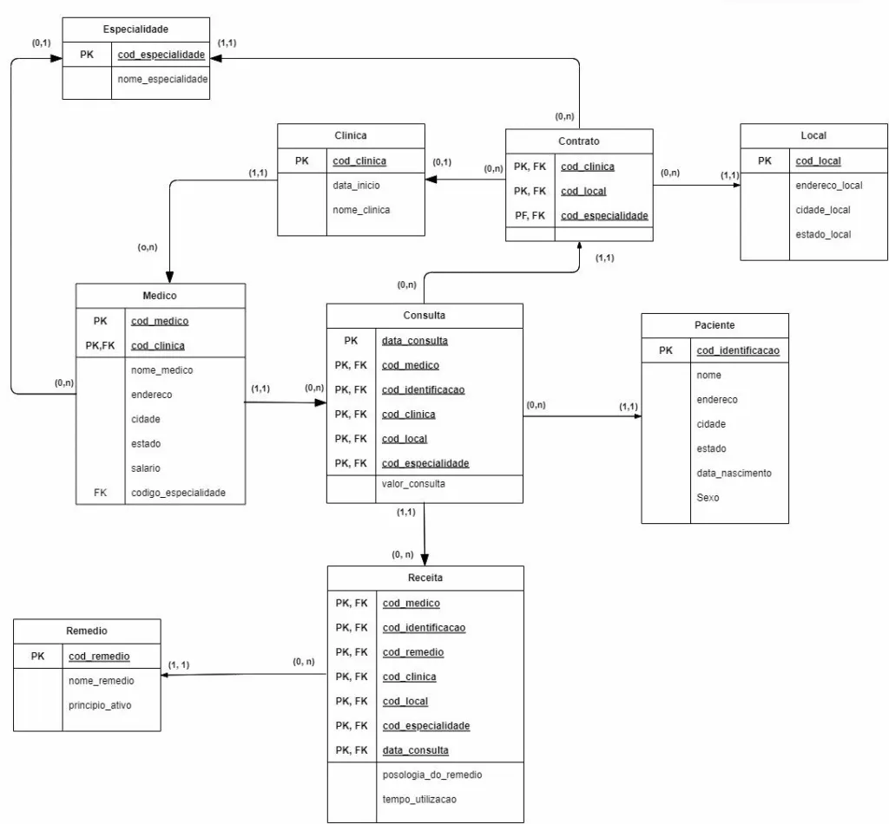
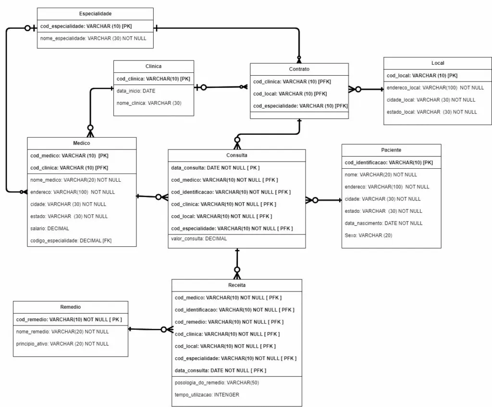
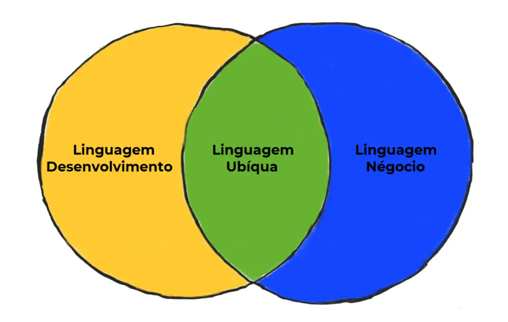

## TL;DR

- Start modeling data without tying it to any particular technology; gather requirements first and avoid locking the model to a specific database.
- Split the process into three stages: conceptual (entities and relationships), logical (attributes and keys), and physical (implementing with appropriate data types and indexes).
- Plan for changing requirements with techniques like DDD and use access patterns during the physical modeling phase to define indexes that keep your database scalable.

Getting the modeling right early reduces bottlenecks when your system handles heavy reads and writes. Postponing it is just piling on technical debt.

This post teaches the fundamentals of database modeling so you can apply them to your own projects.

## Model the data independently of the database

At this stage you should not already be thinking about any specific database technology such as MySQL, PostgreSQL, Oracle, or MongoDB. If you start there, you bias the model toward the chosen database and create a dependency that becomes a problem if you ever need to change the storage later. The whole model would need a rewrite if that happens.

Before modeling, gather the project requirements. They serve as your guide to defining entities and their relationships.

## There are three modeling types

### Conceptual model

This is where you define the entities and how they relate (1:1, 1:N, N:N). At this stage, the main elements are entities, attributes, and relationships.

The goal is to capture requirements and business concepts in a clear, non-technical representation that everyone involved can understand.

Tip: If the project is not for a large company or there are few non-technical stakeholders, you can skip this step and start directly with the Logical Model to save modeling time.

_Conceptual Model — Image credit: Igor Nascimento Alves_

### Logical model

Here you define the attributes (data) of your entities, including primary and foreign keys. The logical model translates the conceptual thinking into a more detailed structure without tying it to any technology.

The goal is to create a technical blueprint for the database while remaining abstract enough to stay technology-agnostic.

Some tools that help with modeling:

- [Lucid.co](https://lucid.co/)
- [Eraser.io](https://eraser.io/)
- [Draw.io](https://draw.io/)

_Logical Model — Image credit: Igor Nascimento Alves_

### Physical model

In the final stage, you apply database-specific characteristics to the logical model you already built. This is the implementation step where each technology choice matters, and you define data types and how data is organized.

The goal is to optimize the model for the chosen technology and ensure the database performs efficiently. This is the stage where you evaluate which SQL or NoSQL system best fits the project.

Physical Model — Image credit: Igor Nascimento Alves

### In summary:

- The conceptual model defines entities and how they relate (1:1, 1:N, N:N);
- The logical model fleshes out the attributes of your entities, including keys;
- The physical model applies database-specific characteristics to the logical model, implementing it in a chosen technology;
- The conceptual model captures business requirements, the logical model turns them into a comprehensible data structure, and the physical model implements the detailed version in the target database environment.

## Challenges you might face along the way

The most common challenges are constant requirement changes and database scalability.

### Changing requirements

Requirements change all the time in a dynamic business environment. As user needs evolve or new requirements emerge, the data models must adapt accordingly. That introduces challenges like keeping consistency across versions and ensuring changes don't break existing data integrity.

Domain-Driven Design (DDD) techniques can help you understand those changes better. DDD helps you grasp the business rules. Requirements, rules, and business domain are closely related and evolve together throughout the project life cycle. To stay aligned with requirements, learn about the domain experts, their language, and how to work with the ubiquitous language.

DDD Language Diagram

### Database scalability

Scalability is crucial in systems that handle large volumes of data or growing concurrent users. Non-scalable data models can cause performance degradation, long response times, and maintenance headaches.

Starting at the physical modeling stage, think about Access Patterns to define indexes for your database. After analyzing query frequencies, identify patterns such as:

- Listing all users;
- Finding a user by email;
- Listing a user's orders;

Once you define these patterns, you can add indexes on frequently queried fields.

Indexes are auxiliary structures that speed up data retrieval. Think of them like a table of contents that points to specific information instead of scanning every row. They make queries faster and reduce the server's computational load.

## Key takeaways

- Gather requirements before modeling the database. Techniques from Domain-Driven Design (DDD) help you understand the business rules;
- Model independently of the database. Use the three phases: conceptual, logical, and physical;
- Only the physical model should worry about database technology (SQL, NoSQL, MySQL, PostgreSQL, Oracle, MongoDB, etc.);
- Analyze Access Patterns and add indexes during the physical modeling phase to ensure scalability as the project grows;

This post reflects a slice of my studies!

All the reflections here happened while I consumed these materials:

[Database Design course — JSTack](https://jstack.com.br/)

[What is data modeling for? — Blog Alura](https://www.alura.com.br/artigos/modelagem-de-dados)

---

> A database without modeling is an MVP: Many Problematic Variables. :)
